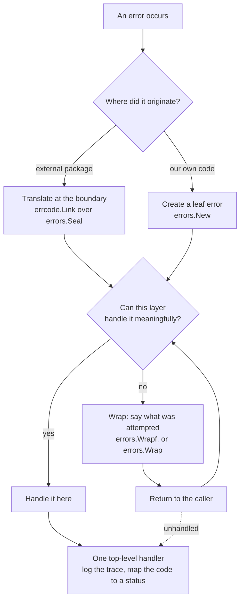
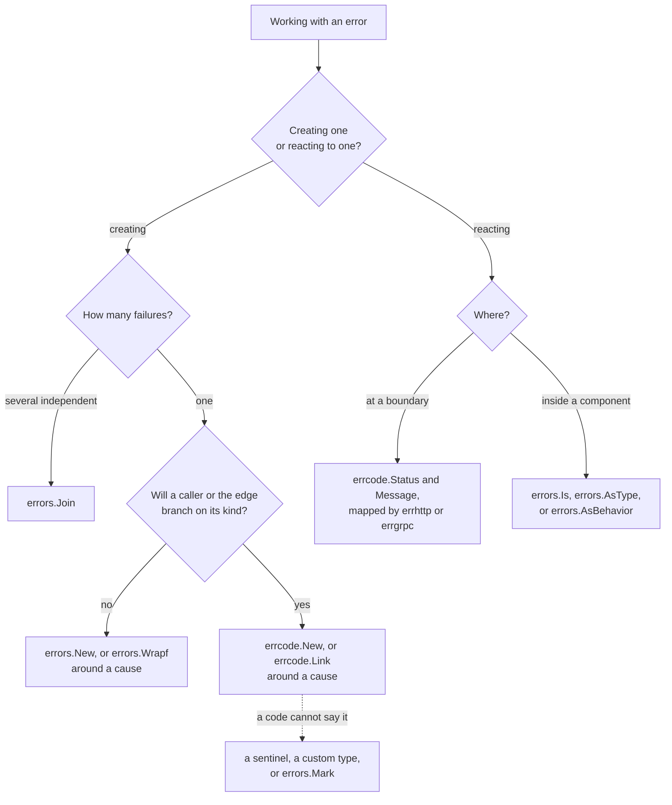

# How to Handle Errors in Go

Go treats errors as ordinary values: a function that can fail returns an
`error` as its last result, and the caller checks it. Go has no `try`/`catch`
and no stack unwinding. This looks verbose at first, but it makes the failure
path explicit.

Let's do a quick review of the conventions:

- A function returns both data and an error. A non-nil error value means that an error occurred.
- Check the error before using any data returned from a function.
- If there is an error, short-circuit the rest of the function.
- Specific error messages are prepended to an existing error.
- Error messages should start with a lower-case letter.
- Error messages should not have line breaks or periods.

None of these conventions are required by the compiler, but we will have a much easier time if we follow them.

This guide starts from the standard library and builds up to the techniques this
repository provides. Each section answers one question: *in this situation,
which tool do I reach for, and why?* For how responsibilities split between this
library and your own application code, see
[Mechanism and Domain](./mechanism-and-domain.md).

## The Error Interface

Every error in Go satisfies one small interface:

```go
// Any type with an Error() string method is an error.
type error interface {
	Error() string
}
```

`Error()` returns a human-readable message. By convention the message is
lowercase and has no trailing punctuation, because callers frequently wrap it
inside a larger sentence.

## Checking an Error

The most common pattern is to check for `nil` and stop early:

```go
file, err := os.Open("config.yaml")
if err != nil {
	return fmt.Errorf("open config: %w", err)
}
defer file.Close()
```

Handle the error where you check it, or return it to someone who can. The one
thing never to do is ignore it, a discarded error is a bug that has not
happened yet.

## A Drop-in `errors` Package

This repository's root package,
`github.com/StevenACoffman/toerr/errors`, is a drop-in replacement for the
standard library. It re-exports `Is`, `As`, `Unwrap`, and `Join` unchanged, and
adds four things the standard library leaves out:

- `New`, `Wrap`, and `Wrapf` **record where they were called** (file, line,
  function), so the message can say what was being attempted and leave the
  location to the library.
- `New`, `Wrap`, and `WrapWithMessage` accept trailing `slog.Attr` values, so an
  error carries **structured context** for logging, not just a string.
- `Mark` / `AsType` let you **tag an error for control flow** by type, and `Seal`
  **hides an error from matching** without hiding it from operators.
- Errors render a **return trace** under `%+v`, and `errors.LogValue` /
  `errors.Attrs` turn one into structured log fields at your log boundary.

```go
import errors "github.com/StevenACoffman/toerr/errors"
```

The rest of this guide uses that package.

## Classifying an Error: a Code or Nothing

Most errors need no classification. The edge logs them and answers with a generic
failure, and nothing in between branches on what kind of failure it was. Create those
with `errors.New`, and wrap them with `errors.Wrapf` or `errors.Wrap`.

When a caller or the edge must branch on the kind of failure, attach an `errcode`
status: `errcode.New` where the failure starts, `errcode.Link` around a cause. One
small, shared set of codes serves every package and every transport, and each code
says whether a retry can help (see
[Deciding Retries at a Boundary](#deciding-retries-at-a-boundary)).

The sections that follow cover what to reach for when a code cannot say it:

- a **sentinel**, for one well-known value a caller compares by identity
- a **custom type**, for fields a caller reads
- a **mark**, to give an error whose type you don't own a meaning of yours
- a **behaviour**, for a question an error answers whatever its type
- an **`errclass`**, for a severity that folds across a batch inside a component

Each one is a name a caller couples to, so add one only when a caller needs it.

## Sentinel Errors: Comparing Identity with `errors.Is`

A sentinel is a predefined error value that callers can recognize. Define it
once at package level with the `Err` prefix. Use the `sentinel` package, whose
values are cheap, and they do not capture a stack (a stack taken at package-init
time would be meaningless):

```go
var ErrNotFound = sentinel.New("resource not found")

func findUser(id string) (string, error) {
	if id == "" {
		return "", ErrNotFound
	}
	return "Alice", nil
}
```

Compare against a sentinel with `errors.Is`, not `==`. `errors.Is` walks the
whole chain of wrapped errors, so it keeps working even after the sentinel has
been wrapped with extra context:

```go
if _, err := findUser(""); errors.Is(err, ErrNotFound) {
	fmt.Println("user was not found")
}

// Standard-library sentinels work the same way.
if errors.Is(err, io.EOF) {
	fmt.Println("reached end of input")
}
```

A sentinel matches by **identity**, so it must be a package-level variable:
two independent `sentinel.New("not found")` values are deliberately not equal.
Reach for a sentinel when callers only need to answer a yes/no question: *is this
that specific, well-known condition?*

## Custom Types and Marks: Reacting by Type with `errors.As` / `AsType`

When callers need structured information, a status code, a field name, a
retry-after duration, define a type instead of a bare value:

```go
type APIError struct {
	StatusCode int
	Endpoint   string
	Message    string
}

func (e *APIError) Error() string {
	return fmt.Sprintf("api %d at %s: %s", e.StatusCode, e.Endpoint, e.Message)
}
```

Pull the concrete type back out with `errors.As`, which, like `errors.Is`,
searches through wrapping:

```go
var apiErr *APIError
if errors.As(err, &apiErr) {
	fmt.Println("status:", apiErr.StatusCode)
}
```

Go 1.26's generic `errors.AsType` (re-exported here) skips the pre-declared
variable and returns the found value plus a boolean:

```go
if apiErr, ok := errors.AsType[*APIError](err); ok {
	fmt.Println("status:", apiErr.StatusCode)
}
```

`AsType` also works with **marks**. `Mark` tags an existing error with a marker
whose type `AsType` will then recognize, without changing the error's message or
its `Unwrap` chain. If the error was not produced by this package, `Mark` wraps
it first so it still carries a trace:

```go
var ErrRateLimited = &RateLimitError{}

err = errors.Mark(err, ErrRateLimited)                // transparent tag
if _, ok := errors.AsType[*RateLimitError](err); ok { // matches anywhere up the chain
	backoffAndRetry()
}
```

A sentinel works as a marker too: `errors.Mark(err, ErrQuota)` makes
`errors.Is(err, ErrQuota)` true, still without putting `ErrQuota` in the chain.
`Mark` is for errors whose type you do not own. When you construct the type
yourself, give it an `Unwrap` or `Is` method that returns your sentinel instead.

Prefer a custom type or a mark when callers must *branch on a category* that a code
cannot name. Prefer a sentinel when they match a single well-known value.

The `StatusCode` field in `APIError` stands for an *upstream* API status,
illustrative structured data, not this service's own transport status.
Do not bake your own HTTP or gRPC status into an error type; carry it as a domain
code and map it at the edge (see
[Domain Codes and Boundary Translation](#domain-codes-and-boundary-translation)).
For most application errors a code is simpler than a bespoke struct.

### Seal: the Opposite of a Mark

`Mark` adds a match without changing what operators see. `Seal` removes every match
without changing it either. `errors.Is`, `errors.As`, `AsType`, and `AsBehavior` stop
at the seal, and so do an `errcode` code or message, an `errclass` class, and any mark
beneath it. The message, the `%+v` trace, `errors.Attrs`, and `errors.LogValue` still
show everything.

Seal a dependency's error where it enters your domain, then attach your own meaning
outside the seal:

```go
if errors.Is(err, sql.ErrNoRows) {
	return errors.Mark(errors.Seal(err), ErrNotFound) // callers can match ErrNotFound only
}
```

**Seal the cause, not the result.** `errors.Seal(errors.Mark(err, ErrNotFound))` hides
the sentinel you just attached, and `errors.Seal(errcode.Link(…))` hides the code. A
seal records no frame of its own: the wrap or mark around it records the location.

## React by Behavior: Asking an Error a Question with `AsBehavior`

`Is` matches on *what an error is* (identity) and `As` / `AsType` on *what type it
is*. Sometimes you care instead about *what it can do*: is it retryable, is it a
timeout? Define a small behavior interface and let any error that answers those
methods match, whatever its concrete type. This is the pattern behind the standard
library's `net.Error` (`Timeout() bool`).

```go
type retryable interface{ Retryable() bool }

if r, ok := errors.AsBehavior[retryable](err); ok && r.Retryable() {
	backoffAndRetry()
}
```

`AsBehavior` is the behavior counterpart to `AsType`. `AsType[T]` needs `T` to be an
error type, but a behavior interface usually is not an error (it has no `Error()`
method), so `AsType` cannot express it and `AsBehavior` can. Like `As`, it looks
through wrapping, finds behaviors attached with `Mark`, and traverses every branch of
an `errors.Join`. `T` must be an interface; passing a concrete type is a programming
error and panics.

Because the match is by method, the caller couples only to its own one-method
interface, not to your concrete type or a shared sentinel. To give a foreign error a
behavior without owning its type, attach one with `Mark`:

```go
// *RateLimitError answers Retryable(); Mark tags err with it transparently.
err = errors.Mark(err, &RateLimitError{})
```

Reach for a behavior when the answer is *intrinsic to the error* and you want callers
to stay decoupled from its type. Prefer a sentinel for a single well-known value, a
code (`errcode`) for a category the application branches on, and `errclass` for a
coarse transient-vs-persistent severity that folds across joins. Keep behavior
interfaces small and their meaning crisp: the standard library deprecated
`net.Error.Temporary()` precisely because its meaning was ambiguous. A behaviour
answers anywhere in the chain, so judge it again where an error leaves your component
(see [Deciding Retries at a Boundary](#deciding-retries-at-a-boundary)).

## Wrapping for Context, and What `%w` Leaves Out

As an error travels up the call stack, each layer can add context with the `%w`
verb:

```go
data, err := os.ReadFile(path)
if err != nil {
	return nil, fmt.Errorf("load config %q: %w", path, err)
}
```

`%w` records the wrapped error as a *value*, so `errors.Is` and
`errors.As` keep working through the chain. The resulting message reads as a
trail of context:

```text
init app: load config "/etc/app.yaml": open /etc/app.yaml: no such file or directory
```

**But `fmt.Errorf` captures no file, line, or function.** It only concatenates
strings. When that message shows up in a log, you get the *what* but not the
*where*, you are left grepping the source for the literal text `load config`.

This repository closes that gap without giving up the message. `Wrapf` prefixes a
formatted message, as `fmt.Errorf` does, and records the call site;
`WrapWithMessage` does the same with a fixed message and trailing attributes; a bare
`Wrap` records only the call site:

```go
// Wrapf: say what was being attempted, plus location.
if err != nil {
	return errors.Wrapf(err, "load config %q", path)
}

// WrapWithMessage: the same, with identifiers as attributes.
if err != nil {
	return errors.WrapWithMessage(err, "charge card", slog.Int("order", id))
}

// Wrap: location only, for a hop that adds nothing about intent.
if err != nil {
	return errors.Wrap(err)
}
```

Render the accumulated trace when you log, with `%+v`:

```go
slog.Error("request failed", "err", fmt.Sprintf("%+v", err))
```

```text
load config "/etc/app.yaml": open /etc/app.yaml: no such file or directory

main.loadConfig
	/app/config.go:14
main.initApp
	/app/init.go:9
```

### Context Chain, Return Trace, Stack Trace

An operator reading a failed request can ask three different questions, and each one
has its own record:

| Record        | Answers                                                  | Recorded by                                              |
| ------------- | -------------------------------------------------------- | -------------------------------------------------------- |
| Context chain | What was the program trying to do?                       | messages and `slog` attributes, one layer at a time      |
| Return trace  | Which layers passed the error on instead of handling it? | one frame per `New`, wrap, or `errcode` constructor      |
| Stack trace   | Which functions were on the stack when it was created?   | a runtime snapshot; here only `errors.Recover` takes one |

None of them replaces another. The context chain is the one an operator reads first,
because it is the only one that carries intent: `charge card: authorize payment:
connection refused` says what failed in the program's own terms. Frames are mechanical.
They name a function and a line, and they mean something only with that commit's
source open. The return trace's own contribution is propagation: each frame marks a
layer that chose not to handle the error, so it shows where handling should have
happened. A stack trace shows how the program reached the creation site, which matters
when the bug is at that site.

`fmt.Errorf` records only the context chain. A bare `Wrap` records only a frame.
`Wrapf` and `WrapWithMessage` record both. `errors.LogValue` writes both records as
fields of one log line: each layer's `msg` and `attrs` are the context chain, and its
`at` is the return trace.

Intent has a home at each scope, and it is cheapest to record where it is known:

- **Per request**: the request ID and the authenticated user, and what the request
  found on the way, such as a cache hit. Record them once with `logctx.Add`, on the
  request's context, and the boundary writes them with the request's one log line
  (see [Collecting a Request's Fields](#collecting-a-requests-fields)). Don't repeat
  them on every wrap. For a request that crosses services, put them on its trace span
  too.
- **Per task**: which job, shard, or item a goroutine was working on. Only the code
  that starts the task knows that, so attach it there (see
  [Errors Across Goroutines](#errors-across-goroutines)).
- **Per step**: what this function was attempting. Write it as the message of the
  wrap, with identifiers as attributes.

### How Often to Wrap

Add a message wherever you know what was being attempted, as in
`Wrapf(err, "load config %q", path)` or
`WrapWithMessage(err, "charge card", slog.Int("order", id))`. Name the operation in the
message and put identifiers in attributes, where logs can query them. Format a value
into the message only when the message means little without it, as a path usually
does.

Use a bare `Wrap` for a hop that passes the error on without adding meaning, where
only the location is new. It is cheap and message-free, so the density of those is your
choice, not the package's. You can wrap at *every* return for a dense trace, or only
where an error crosses a *package* boundary (the level the `wrapcheck` linter enforces)
for a sparse one. A run of same-package pass-throughs that add no message is noise.
For whether a return trace is worth adopting in your project at all, see the README's
"When Not to Reach for This" section.

### Return Trace, Not Stack Trace

Each `New` and `Wrap` records a single frame, its own call site. Collected along
the chain and printed origin-first, they form a **return trace**: the path the
error took as it was returned out to the caller.

An `Op` string, in the older *logical stack trace* convention, did two jobs. Naming
the function, as in `"sqlite.UserService.CreateUser"`, records location, and the frame
now records that for you, so there is no function-name `Op` to write or keep in sync.
Naming the operation, as in `"create user"`, records intent, and nothing records that
for you. Keep it as the message:
`errors.WrapWithMessage(err, "create user", slog.String("invite", id))`.

A return trace is a different record from a stack trace. A stack trace is captured
once, at creation, and answers *how did we get to where the error started?* A return
trace is built incrementally, one frame per wrap, and answers *how did this escalate
on its way out?* Because it is assembled as the error propagates, it still answers
that question when the error is sent over a channel or returned from another
goroutine: the frames after the hop show which collector passed it on. What they
cannot show is which task failed, because the frames record plumbing, not purpose.
That is context-chain information, and it has to be attached where the task starts.
No full stack and no runtime tail: `%+v` shows only the frames you wrapped through.
This follows the `braces.dev/errtrace` model.

The trace machinery keys off `errtrace`'s exported marker interface, any error
with a `TracePC() uintptr` method contributes a frame, and this package's errors
satisfy it, so the two packages interoperate: an `errtrace.Wrap`-ed error
nested in one of these chains appears in `%+v`, and these errors appear in
`errtrace.Format`. You can mix them without losing frames from either.

## Combining Independent Failures with `errors.Join`

`%w` models a **chain**: this failed *because* that failed. Sometimes you instead
have several **independent** failures that all matter at once, validation of
many fields, errors from a batch of goroutines, or a cleanup that fails while
handling an earlier error. `errors.Join` collects them:

```go
func validate(name, email string) error {
	var errs []error
	if name == "" {
		errs = append(errs, errors.New("name is required"))
	}
	if email == "" {
		errs = append(errs, errors.New("email is required"))
	}
	return errors.Join(errs...) // nil if errs is empty
}
```

`Join` returns an error whose `Error()` is the children joined by newlines, and
whose `Unwrap() []error` method exposes the slice. This is a different interface
from single wrapping (`Unwrap() error`), and it shapes how joined errors behave:

- `errors.Is` and `errors.As` (and therefore `AsType`) traverse **every** branch,
  so a sentinel or type buried in one of the joined errors is still found.
- To inspect the branches yourself, type-assert the multi-error interface:
  `if m, ok := err.(interface{ Unwrap() []error }); ok { … m.Unwrap() … }`.
- Consumers can fold across the branches. `errclass.GetClass` does exactly this:
  it walks the joined errors and returns the most severe class (`Transient` vs
  `Persistent`), so one persistent failure makes the whole batch persistent.
- `%+v` renders a joined error as a tree, drawing each branch under a `+-`
  connector with `|` gutters and the wrapping error's own trace at the bottom.
  `errors.LogValue` writes the same tree as JSON, each branch under `errors`, so
  siblings that set the same attribute key keep their own values.

Use `%w` for a causal chain and `errors.Join` for a set of siblings. They
compose: a joined error may contain wrapped errors, and a wrapped error may wrap
a joined one.

## Errors Across Goroutines

A goroutine hands its error back through a channel, a struct field, or an `errgroup`,
and the receiving side knows less about the work than the sending side did. Three
habits keep the context chain whole across that hop.

**Name the task where it starts.** The frames after the hop show which collector passed
the error on, never which task failed. Only the code that starts the task knows that,
so wrap there. `WrapWithMessage` returns nil for nil, so it can be the last line:

```go
for n, shard := range shards {
	g.Go(func() error {
		return errors.WrapWithMessage(render(ctx, shard), "render shard",
			slog.Int("report", id), slog.Int("shard", n))
	})
}
```

The same holds for fields the task records on success. Hand the goroutine its own
`logctx.Scope(ctx, fmt.Sprintf("shard_%d", n))`, so its fields land under that name
and no sibling's can overwrite them.

**Report why a context ended.** Work that stops on `ctx.Done()` usually returns
`ctx.Err()`, which is `context.Canceled` or `context.DeadlineExceeded`: it says the
context ended, and not why. Code that ends a context for a reason, such as a shutdown
or a spent time budget, should state it with `context.WithCancelCause`,
`WithTimeoutCause`, or `WithDeadlineCause`, and the work should report
`context.Cause(ctx)`. `errgroup.WithContext` already sets the cause to the group's
first error. The cause replaces `ctx.Err()`, so mark it with `ctx.Err()` to keep
`errors.Is(err, context.Canceled)` true for callers that check it:

```go
select {
case <-ctx.Done():
	return errors.WrapWithMessage(errors.Mark(context.Cause(ctx), ctx.Err()),
		"wait for shard", slog.Int("shard", n))
case r := <-results:
	return use(r)
}
```

**Keep the failures that matter.** `errgroup`'s `Wait` returns the first error and
drops the rest. When one failure cancels the others, the first is usually the one
that matters and the rest only report the cancellation. When the tasks fail
independently, as items in a batch do, collect every error and join them:

```go
var (
	g    errgroup.Group // no shared context: one failure does not cancel the rest
	mu   sync.Mutex
	errs []error
)
for _, item := range items {
	g.Go(func() error {
		if err := process(item); err != nil {
			mu.Lock()
			errs = append(errs, errors.WrapWithMessage(err, "process item",
				slog.String("item", item.ID)))
			mu.Unlock()
		}
		return nil
	})
}
_ = g.Wait() // every task returns nil; the failures are in errs
return errors.Join(errs...)
```

## Domain Codes and Boundary Translation

Callers should not have to know that your storage layer happens to use
`database/sql`, or that a lookup used the filesystem. Errors like `sql.ErrNoRows`
and `os.ErrNotExist` are internal details, **translate them into a domain
code at the boundary** before they escape, rather than letting callers match on
them directly.

This repository uses `errcode` for that. A small, transport-neutral set of status
codes lives in one place:

```go
func (s *Store) FindUser(ctx context.Context, id int) (*User, error) {
	u, err := s.query(ctx, id)
	if errors.Is(err, sql.ErrNoRows) {
		// Seal the cause: callers branch on the code, never on sql.ErrNoRows.
		return nil, errcode.Link(errcode.StatusNotFound, "user not found", errors.Seal(err))
	}
	if err != nil {
		// No caller branches on this failure, so it needs no code; seal it all the same.
		return nil, errors.Wrapf(errors.Seal(err), "find user %d", id)
	}
	return u, nil
}
```

A single `errcode.Link` call carries a code, a user message, and the cause together,
one translate-and-wrap layer rather than the classic split (a *leaf* holding code
and message, a separate *wrapper* holding the cause). The one choice to make is
whether callers may match the cause. `Link` keeps it in the `Unwrap` chain, so
callers can `errors.Is`/`As` into it (the `%w`-style contract). Sealing the cause
first, `Link(code, message, errors.Seal(err))`, stops every match at the seal (the
`%v`-style translation), while operators keep the cause's text, trace, and attributes.
That seal is what "translate before they escape" means in practice: after it,
`errors.Is(err, sql.ErrNoRows)` is false, so switching storage engines cannot break a
caller. Seal when hiding a dependency, and link without a seal only when the cause is
your own. An error no caller branches on, like every other database error here, needs
a seal and a message but no code: it is a code or nothing, and the edge answers it as a
generic failure. With pgx, `errpgx.FromError` chooses the code for every database error,
so a connection failure answers `StatusUnavailable` instead of looking like a bug:
`errcode.Link(errpgx.FromError(err), "", errors.Seal(err))`. `Link` returns nil for a nil
cause, as `errors.Wrap` does. Where the failure starts in your own code, with no cause
to carry, `errcode.New(code, message)` is the coded leaf. Give every coded leaf a
message. Without one, it renders as its code in words (`not found`), and the user
sees only the transport's generic text.

A dependency's code needs the same translation as its error. Google's error model
says a service "should not blindly propagate errors" from the services it depends
on, and should "adjust the party responsible for the error. For example, a server
that receives an `INVALID_ARGUMENT` error from another service should propagate an
`INTERNAL` to its own caller." A downstream `InvalidArgument` says your request to it
was wrong, and a downstream `PermissionDenied` that your service's grants were;
your caller can fix neither. `errgrpc.FromError` and `errpgx.FromError` make that
adjustment, so each returns the code of your operation rather than of the call it
made.

`WithCode` and `WithCodeOpaque` are deprecated spellings of `Link` and of `Link` over a
sealed cause. Until their removal in the first release after v0.4.0, they behave as
they always have, so a nil cause still gives a coded leaf.

At the edge of the program, read the code back and map it to the transport,
without knowing anything about the concrete error type:

```go
func writeError(w http.ResponseWriter, err error) {
	status, message := errhttp.Error(err) // maps the domain code to HTTP here
	http.Error(w, message, status)
}
```

The domain code lives in `errcode`. The HTTP mapping lives in the `errhttp` adapter,
and the gRPC mapping in `errgrpc`, a module of its own that also maps a client call's
code back into the domain. `errcode` imports no transport package, so the same coded
error serves HTTP, gRPC, or a CLI unchanged, and each transport gets its own thin
adapter.

Say in each exported function's godoc which codes and sentinels it returns. It is the
part of the contract that Go's `error` type leaves out of the signature. Within this
repository, every switch on `errcode.StatusCode` omits its default arm, so the
`exhaustive` linter (with `default-signifies-exhaustive`) fails the build until a
new code is handled. Do the same in your own switches.

### Deciding Retries at a Boundary

A code tells the caller what to do, not only what happened. That is error domains
applied to the response: whether a failure is transient or permanent, and whether
repeating the request is safe, is often worth more to the caller than what went
wrong. At a boundary, decide whether to retry from `errcode.Status` alone. Each code's
godoc says whether a retry can help, following Google's
[AIP-194](https://google.aip.dev/194):

- `StatusUnavailable`: retry with backoff, if the operation is idempotent.
- `StatusResourceExhausted`: don't retry automatically. A quota may take hours to
  refill, and each retry may be billed; background work may retry after a long delay.
- `StatusAborted`: retry the whole read-modify-write, not the last step.
- `StatusDeadlineExceeded`: the operation may have completed, so don't retry it
  automatically; the application may repeat an idempotent one.
- Every other code: the same request fails the same way until something else
  changes, such as the input, the system's state, or the code.

Two codes are not failures of the operation at all, and belong out of the error rate
and the alerts. `StatusCanceled` means the caller gave up: there is nothing to retry,
and the line belongs below error level. `StatusDeadlineExceeded` means time ran out:
count it as a timeout. Google's HTTP mapping for these gRPC codes, which grpc-gateway
follows, is 499 Client Closed Request and 504 Gateway Timeout. A handler often returns
its context's error with no code on it, so read the code at a boundary with
`errcode.ForTransport`, as `errhttp.Error` and `errgrpc.Error` do. It treats an error
without a code that wraps `context.Canceled` or `context.DeadlineExceeded` as those
codes, as grpc-go's server does:

```go
if code, _ := errcode.ForTransport(err); code == errcode.StatusCanceled {
	level = slog.LevelInfo // the caller left; nothing failed
}
```

A seal hides a context error like any other cause, so the boundary sees it only if it
is outside every seal.

`errclass` and behaviour interfaces such as `Retryable()` answer the same question
inside a component. They match anywhere in the chain, and that is the hazard at a
boundary. A database error that answers `Retryable() == true` still answers through a
plain `Link`, even when the outer operation charged a card and cannot be repeated. A
retryable cause doesn't make the operation retryable. Judge retryability where the
error leaves the component. Give it the code that is true of the operation, and seal
the cause so that nothing beneath the seal answers for it.

Don't let `StatusInternal` become the code for everything unclassified. When nobody
knows which code to use, `StatusInternal` is the one that feels safe, and it becomes
the `throws Exception` of status codes: it says an invariant broke, which no retry
fixes, so an outage reported as `StatusInternal` looks like a bug and is never retried.
That is a matter of discipline, not of the code set. Leave an error you cannot
classify without a code, say `StatusUnavailable` when a dependency was down, and let
an adapter such as `errpgx` choose the code for a driver's errors.

The program is not the only reader of a code. Infrastructure between the caller and
the server acts on it without asking:

- gRPC retries a method only for the codes its service config lists in
  `retryableStatusCodes`, which in gRPC's own example is just `UNAVAILABLE`. Without a
  policy it retries only what it knows the server never processed.
- Envoy, and the meshes built on it, retry gRPC `unavailable`, `resource-exhausted`,
  `deadline-exceeded`, `cancelled`, or even `internal`, and HTTP `5xx`, 502 to 504, or
  409, as each route is configured.
- Retry middleware in clients and load balancers can do the same with whatever codes
  it was given.

None of them knows whether an operation is idempotent, so turn their retries on only
for routes that are. HTTP also merges codes whose advice differs: 409 carries both
`StatusAlreadyExists`, which no retry fixes, and `StatusAborted`, which a retry of the
whole transaction can, and 504 carries `StatusDeadlineExceeded`, which only an
idempotent operation should repeat. Where the difference matters to a proxy, gRPC's
codes keep it.

Retry at one layer. Each layer that retries multiplies the attempts of every layer
beneath it: Google's SRE book counts one user action becoming 64 attempts on the
database when three layers each try four times. A service that already retried a
downstream call, or that is overloaded, should not answer with a code that tells its
own caller to retry as well, and AIP-194 retries `StatusAborted` at the level above,
around the whole transaction, not the request that failed.

### Three Audiences, Three Views

One error serves three consumers, and each gets a different view, never the same
one:

- The **application** branches on the machine code: `errcode.Status(err)`.
- The **end user** sees a safe, human message: `errcode.Message(err)` (or, at an
  HTTP edge, `errhttp.Error`). When it is empty, supply your own generic text:
  `cmp.Or(errcode.Message(err), "something went wrong")`.
- The **operator** gets the full detail and return trace: `errors.LogValue(err)` as
  a structured log field, or `fmt.Sprintf("%+v", err)` as text.

Keep the code and the message in agreement. `Status` reads the outermost code, and
`Message` the outermost non-empty message, so a wrap that changes the code without a
message of its own still shows the message beneath it. This answers a 500 that says
"Seat not found.":

```go
errcode.Link(errcode.StatusInternal, "", errcode.New(errcode.StatusNotFound, "Seat not found."))
```

A wrap that changes the code should supply its own message, or seal the cause, which
hides the inner message too.

The one rule that ties them together is a security boundary: **never show
`err.Error()` or `%+v` to an end user.** Those are the operator view and may
expose wrapped internal detail (a database error revealing schema, a file path).
Messages from `New`/`WrapWithMessage` are operator-facing; only an `errcode`
message is vetted for users.

### Coming from `Error{Code, Message, Op, Err}`

Many Go codebases use Ben Johnson's single error struct, filled one way for a leaf
and another for a wrap. Each shape has a direct spelling here:

| `Error` literal        | toerr spelling                                            |
| ---------------------- | --------------------------------------------------------- |
| `{Code, Message}`      | `errcode.New(code, message)`                              |
| `{Op, Err}`            | `errors.WrapWithMessage(err, op)`, or `errors.Wrap(err)`  |
| `{Code, Op, Err}`      | `errcode.Link(code, "", errors.WrapWithMessage(err, op))` |
| `{Code, Message, Err}` | `errcode.Link(code, message, err)`                        |

The `{Op, Err}` row renders `op: cause`, exactly as the struct did, and records a
frame besides. Which spelling to pick depends on what the `op` said. An `op` that only
named the function is location, which the frame already records, so `errors.Wrap(err)`
is enough. An `op` that described the operation is intent, so keep it as the message,
and move any identifiers in it to attributes. The `{Code, Op, Err}` row nests a plain wrap
inside the coded one because `Link(code, op, err)` would render
`cause (op)`, reordering the text, and would make the `op` the user-facing
message. The `{Code, Message, Err}` row changes output on purpose: the struct's
`Error()` preferred `Err` and never printed `Message`, and `Link` prints both.

Two habits from the struct do not survive a mixed codebase:

- **A helper must not borrow its caller's `op`.** Under the struct convention a
  helper often takes `op` as a parameter so its errors name the operation the
  caller is performing. Its error then already starts with `op`, and a caller that
  wraps it again prints `op: op: …`. Either give the helper its own `op`, or return
  its error unwrapped, or drop function-name strings and let the frames name each
  hop.
- **An `op` never goes in a message.** `{Code, Op, Message}` leaves were often
  flattened to a message of `op + ": " + text`. In `errcode` that message is the
  user-facing one, and an internal function name is exactly what `Message`
  promises never to show. Keep `op` in a wrap around the leaf:
  `errors.WrapWithMessage(errcode.New(code, text), op)`.

## Attaching Context for Logs

When the useful context is structured data rather than prose, a user ID, a
request ID, a retry count, attach it as `slog` attributes instead of formatting
it into the message. `New`, `Wrap`, and `WrapWithMessage` all take trailing
attributes:

```go
err := errors.New("checkout failed",
	slog.Int("user_id", id), slog.String("op", "checkout"))
err = errors.Wrap(err, slog.Int("retry", n))
```

At the log site, collect every attribute along the chain with `Attrs` and hand
them to `LogAttrs`:

```go
logger.LogAttrs(ctx, slog.LevelError, err.Error(), errors.Attrs(err)...)
```

`Attrs` descends into every branch of an `errors.Join`. Any error type, including
one declared outside this package, contributes its fields by implementing
`Attrs() []slog.Attr`. Fields it already holds then reach the log without being
copied into a `Wrap`.

The flat list repeats any key two errors both set, such as siblings in a join. A
log backend that decodes JSON into a map, as Google Cloud Logging does, then keeps one
value and drops the rest without a word. Errors deliberately do **not** implement
`slog.LogValuer`, so passing one straight to a logger does not silently expand its
fields at every layer (which invites duplicate log lines). When you want the error
with its shape, ask for it explicitly with `errors.LogValue`:

```go
logger.LogAttrs(ctx, slog.LevelError, "request failed", slog.Any("error", errors.LogValue(err)))
```

It writes the error as a JSON object: each error in a chain is a layer with its own
message, call site, and attributes, and each branch of a join is a tree of its own.
No key is ever written twice, because no two errors share an object.

Either way the message stays a clean one-liner; the structured fields stay queryable
in your log backend.

Note the deliberate split: **context** (open-ended, caller-supplied key/values)
lives in `[]slog.Attr`, while an error's **structure** (its message, cause, and
call site) lives in typed fields. See the README's "structure vs. context"
section for why.

### Collecting a Request's Fields

An error carries what a failure knew, but a request that succeeds has no error. Fields
such as a cache hit, a row count, or the user turn up deep in the handler on either
path. The `logctx` package keeps them on the request's context. Install a collector
where the request starts, add each field where the code learns it, and write one
line when the request ends, with the error beside the fields if it failed:

```go
func serve(ctx context.Context) (err error) {
	ctx = logctx.Init(ctx)
	defer func() {
		recovered := recover()
		if p := errors.Recover(recovered); p != nil {
			err = errclass.WrapAs(p, errclass.Panic)
		}
		level, msg, attrs := slog.LevelInfo, "request served", logctx.Attrs(ctx)
		if err != nil {
			level, msg = slog.LevelError, err.Error()
			attrs = append(attrs, slog.Any("error", errors.LogValue(err)))
		}
		logger.LogAttrs(ctx, level, msg, attrs...)
		if recovered != nil {
			panic(recovered) // net/http, or the goroutine's own recover, still sees it
		}
	}()
	return next(ctx)
}
```

The line is written in a `defer`, so a handler that panics still gets it, at error
level with the panic's stack; the panic then carries on as before.

Beneath it, `logctx.Add(ctx, slog.Bool("cache_hit", true))` records a field from
any layer. The collector is safe for the goroutines a request starts. Give each
parallel branch its own `logctx.Scope`, so two branches' `duration` fields render as
`shard_3.duration` and `shard_4.duration` instead of overwriting each other. Without
`Init`, `Add` does nothing, so a library can record fields and leave the choice of
whether to collect them to the program.

If the volume of these lines forces sampling, sample the requests that succeeded and
keep every failure and panic: a failure's line is the one someone will search for.

`logctx` keeps fields open-ended, so any layer can add one. When a stable schema
matters more, such as for a BigQuery export, where a field must keep one type, a
typed struct per request (as the `logevent` library uses) fixes each field's type at
compile time, at the cost of a schema per endpoint.

## Failure Domains

A failure should cost one request or one job, not the process. That unit is the
failure domain, and panics and shared state are what break out of it.

- **`net/http` recovers a panic in a handler, but not in a goroutine the handler
  starts.** The server logs the handler's panic and closes that one connection. A
  panic on any other goroutine ends the whole process, with every request in flight.
- **Recover where a task starts, and name the task there.** The top of a goroutine is
  the one place that knows both that a panic must stop there and which task it
  interrupted. `errors.Recover` records the panic's stack as a `"stack"` attribute,
  the one stack trace this package takes, because a panic's creation site is the
  record that matters for it:

  ```go
  go func() {
  	defer func() {
  		if err := errors.Recover(recover()); err != nil {
  			results <- errclass.WrapAs(errors.WrapWithMessage(err, "render shard",
  				slog.Int("shard", n)), errclass.Panic)
  		}
  	}()
  	results <- render(ctx, n)
  }()
  ```

- **Shared state is the real risk.** A panic partway through updating a cache, a map
  behind a lock, or a connection's protocol state leaves it half-changed for every
  later request, and recovering does not undo that. Where a panic can leave shared
  state inconsistent, discard the state (evict the entry, close the connection), or
  let the process crash.
- **Panic at detection only where something contains the crash.** Crashing is cheap
  when a supervisor restarts the process and nothing else shares it, as with a
  one-shot job or one replica among many. In a long-lived server, a panic in a
  request's goroutine is recovered and costs only that request; a panic anywhere else
  costs every request in flight.

## Knowing When to Give Up

Not every error is worth handling:

- **Some failures are unrecoverable**: a violated invariant, internal
  inconsistency, out of memory. Prefer to `panic` at the point of detection
  rather than threading a check through code that cannot do anything useful with
  it, where something contains the crash (see [Failure Domains](#failure-domains)).
  Because `toerr` is a library, keep this distinction in mind: this applies
  to application code, which owns the process. Library code should not `panic`
  across its API for ordinary or expected failures; return an error instead,
  recovering internally at the package boundary with `errors.Recover` if some
  dependency panics. Reserve library panics for programmer misuse (as `AsBehavior`
  does on an invalid type argument) or truly unrecoverable invariant violations.
- **Some errors can be designed away.** Redefining an operation as "ensure X is
  absent" (which always succeeds) removes a failure mode that "delete X, error if
  missing" would introduce. The best error handling is the error that can no
  longer occur.
- **Handle an error once, where you can act on it.** Let it propagate to a single
  high-level handler that logs it (with its trace) and turns it into a response,
  instead of logging-and-continuing at every layer.

## How Error Propagation Works

The sections above cover individual decisions. This is how they fit together as an
error travels from where it occurs to where it is finally handled:



The diagram encodes two rules the earlier prose argues for: a wrap adds **intent**
where the layer knows it, and the library adds the **location**; and an error is
**handled once**, at the single top-level handler, rather than logged at every layer
on the way up.

## Choosing a Pattern



## Best Practices Summary

01. Check every returned error. Never discard one with `_` in real code.
02. Compare with `errors.Is` and extract with `errors.As` / `AsType` (or `AsBehavior`
    for a behavior interface): never `==` or a bare type assertion, which miss
    wrapped errors.
03. Say what was being attempted when you wrap (`errors.Wrapf`,
    `errors.WrapWithMessage`), with identifiers as attributes. The library records the
    location; a bare `errors.Wrap` is for a hop that adds nothing else.
04. Translate external errors (`sql.ErrNoRows`, `os.ErrNotExist`) into domain codes
    or sentinels at the boundary, sealing the cause with `errors.Seal`. Do not let
    them leak to callers.
05. Attach an `errcode` status when a caller or the edge branches on the kind of
    failure, and leave other errors unclassified. Reach for a sentinel, a custom type,
    a mark, a behaviour, or `errclass` only when a code cannot say it. Use
    `errors.Join` for independent failures collected together.
06. Keep structured context in `slog.Attr` values on the error, and request-wide fields
    in `logctx`, so the message stays clean. Log once per request, with `logctx.Attrs`
    beside `slog.Any("error", errors.LogValue(err))` in one `LogAttrs` call.
07. Map domain codes to a transport (HTTP status) only at the edge, never inside
    the error type.
08. `panic` on unrecoverable invariant violations instead of threading checks that
    cannot improve the outcome, where a supervisor or a recover contains the crash;
    where you can, design the error out of existence.
09. Return errors rather than logging and continuing: let one high-level handler
    log the error with its trace and decide the response.
10. Never return `(nil, nil)` from a single-entity lookup: a missing entity is a
    not-found error, not a nil result.
11. Keep messages lowercase and free of trailing punctuation.
12. Decide retries from `errcode.Status` at a boundary, and seal or reclassify a cause
    whose retryability doesn't carry over to the outer operation.
13. Document which codes and sentinels each exported function returns, and keep a
    wrap's code and message in agreement.

## The Packages in This Repository

- `errors` (root): the primary API: `New`, `Wrap`, `Wrapf`, `WrapWithMessage`, `Mark`,
  `Seal`, `AsType`, `AsBehavior`, `Recover`, `Attrs`, `LogValue`, and the re-exported
  `Is`/`As`/`Unwrap`/`Join`. Records call sites, carries `slog` attributes, and
  renders a return trace under `%+v`.
- `sentinel`: cheap, stack-free sentinel values for `errors.Is` matching.
- `errcode`: transport-neutral status codes, the gRPC canonical set apart from OK
  (`New`, `Link`, `Code`, `Status`, `Message`). No transport concern lives here.
- `errhttp`: the HTTP adapter for `errcode`: `Status`, `StatusMessage`, and
  `Error(err)` map a domain code to an HTTP status at the boundary.
- `errgrpc`: the gRPC adapter for `errcode`, a module of its own: `Error(err)` for a
  handler to return, and `FromCode` for an error a client call returned.
- `errpgx`: the PostgreSQL adapter for `errcode`, a module of its own: `Status(err)`
  and `FromSQLState` map an error from pgx to a domain code where it leaves a
  repository, and `Attrs` keeps the server's fields for operators.
- `logctx`: a request-scoped collector of log fields (`Init`, `Add`, `Scope`,
  `Attrs`), for the request's one log line on the success and the failure path.
- `errclass`: coarse severity classification (`Transient`, `Persistent`, `Panic`)
  for decisions inside a component. It folds correctly across joined errors.

## Deliberate Non-Choices

A few things this package intentionally leaves out. Each was considered and set
aside to keep the surface small and the behavior predictable.

- **No full stack traces.** Each `New`/`Wrap` records a single frame, its own call
  site, never a captured runtime stack. The result is a return trace (see
  [Return Trace, Not Stack Trace](#return-trace-not-stack-trace)): the path the
  error took on the way out, with no runtime tail and far less allocation than a
  stack snapshot.
- **No function-name `Op` strings.** Tagging each wrap with `"Type.Method"` is
  replaced by the compiler-recorded call site, so there is nothing to write or keep in
  sync. An `Op` that described the operation is not replaced: it is intent, and it
  belongs in the message (see
  [Return Trace, Not Stack Trace](#return-trace-not-stack-trace)). For moving a
  codebase off the `Op` struct, see
  [Coming from `Error{Code, Message, Op, Err}`](#coming-from-errorcode-message-op-err).
- **No deferred/lazy message API.** A `Wrap` variant taking a message *callback*
  (so an expensive message is formatted only when the error is non-nil) was
  prototyped and dropped. In the usual `if err != nil { return WrapWithMessage(err,
  …) }` shape the message is already built only on the error path, and a bare `Wrap`
  adds a frame with no message at all, so the callback form added surface for a
  micro-optimization that rarely pays off.
- **No transport knowledge in `errcode`.** Codes are transport-neutral; the HTTP
  and gRPC mappings live in the `errhttp` and `errgrpc` adapters, so one coded error
  serves HTTP, gRPC, or a CLI (see
  [Domain Codes and Boundary Translation](#domain-codes-and-boundary-translation)).
- **No domain vocabulary in the library.** The library owns the mechanism; your
  application owns the meaning, its sentinels, its reading of each code, and its
  user-facing messages (see [Mechanism and Domain](./mechanism-and-domain.md)).
- **No logging inside the package.** Errors are returned, not logged; a single
  top-level handler logs once, with the trace (see
  [Knowing When to Give Up](#knowing-when-to-give-up)).
